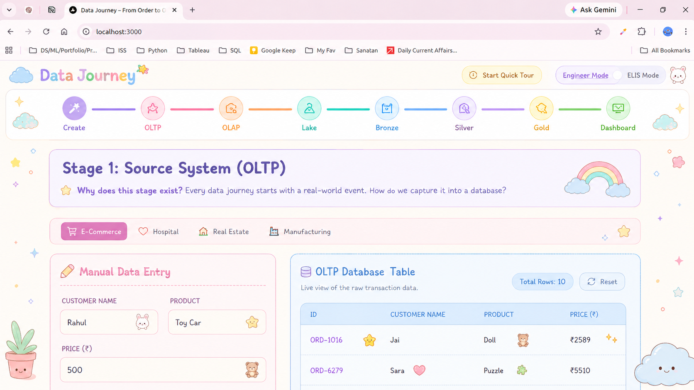

# 🧭 Data Journey: From One Order to a Dashboard

**An interactive web app that teaches beginners how data engineering works by following a single business order through every stage of a modern pipeline, with no code required.**

[](https://de-tutorials.vercel.app)




---

## The idea

Beginners get lost when every stage of a data pipeline is explained with different example data. **Data Journey follows one order the whole way.** You create *"Rahul buys a Toy Car for ₹500"*, and that same record:

```
Create → OLTP → OLAP → Data Lake → Bronze → Silver → Gold → Dashboard
```

shows up dirty in **Bronze**, gets cleaned in **Silver**, counted in **Gold**, and appears on the **Dashboard**, so the learner can narrate what happened to *their* order at every step.

## Features

- **8 interactive stages**, each following the same teaching loop: *feel the problem → do something → see the result → name the concept*
- **One "golden thread" record** tracked across all stages, using React Context
- **4 industry domains:** E-Commerce, Hospital, Real Estate and Manufacturing, each with its own entities, tables and examples
- **Engineer Mode / ELI5 Mode** toggle: explanations for technical users or complete beginners
- **Guided tour** (driver.js), an animated pipeline map (React Flow, Framer Motion) and live charts on the dashboard stage (Recharts)
- **Static, no backend:** deployed on Vercel

## Run locally

```bash
cd data-journey
npm install
npm run dev     # http://localhost:3000
```

## How it was built

- [`DE_Tutortials_prd.md`](DE_Tutortials_prd.md): product requirements, covering the target user, teaching method, stage-by-stage spec and what is deliberately out of scope
- [`tasks.md`](tasks.md): phased implementation plan, tracked as checklists

## Roadmap

From the PRD's out-of-scope list: an AI tutor, cross-session progress, and a "deep dive" mode for data professionals.
